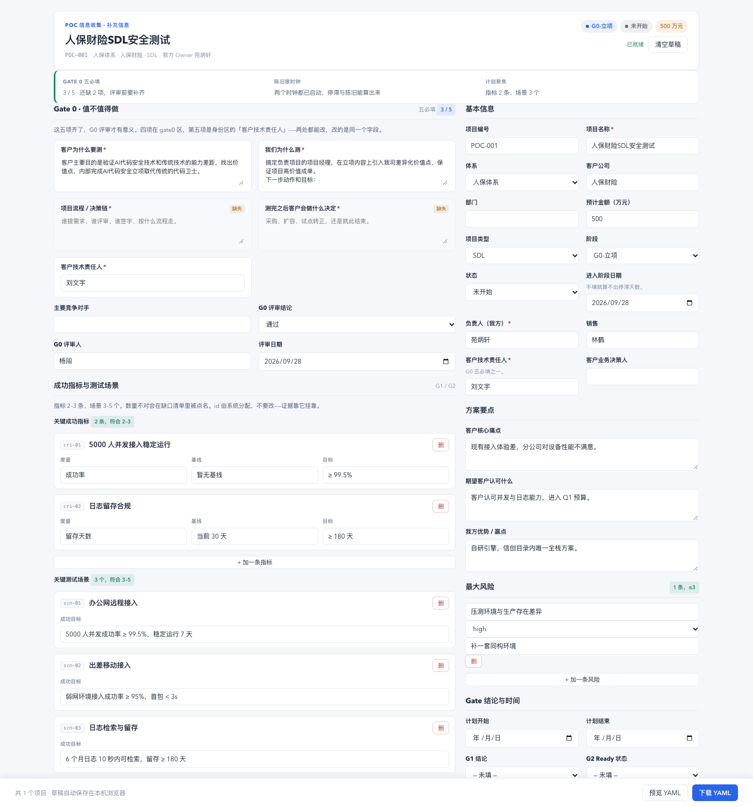
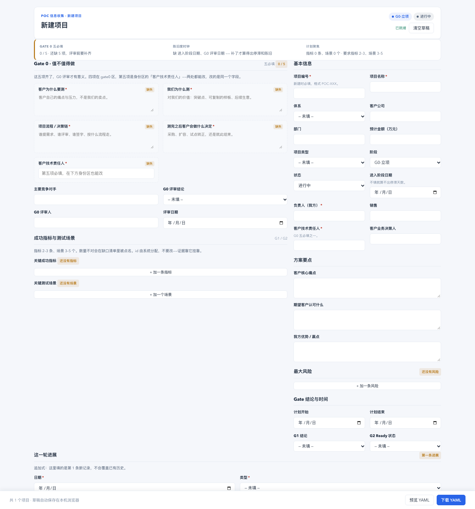

# 导出表单重设计：与详情页对齐

> `poc-export` 生成的 HTML 表单，是**没有 GitHub 账号的组员**唯一能碰台账的入口。
> 它此前是一个通用设置页：一列纵向堆叠的卡片、通用输入框、和详情页毫无关系。
>
> 本文把它重做成**详情页的镜像**：同样的横幅、同样的两栏契约、同样的 Gate 0 网格。
> 顺带修掉三个已在生产里存在的阻断性 bug。

---

## 0. 为什么必须重做，而不只是"美化"

表单和详情页问的是**同一批问题**：

| 详情页展示 | 表单收集 |
|---|---|
| Gate 0 五必填 | `gate0.*` + `tech_owner` |
| 成功指标（带状态） | `plan.criteria[]` |
| 验证场景（带状态） | `plan.scenarios[]` |
| 进展流 | `progress[]`（追加一条） |
| 下一步工作 | `progress[].next` |

同一个信息，一边读一边写。**两边布局不一致的代价是具体的**：组员在表单里填完，
项目负责人在详情页找不到对应位置，于是每次都要重新解释"你填的那条对应这里"。

更糟的是，表单此前的布局**恰好掩盖了缺口**：五个必填项平铺成五个文本框，
一个空白框和另一个空白框长得完全一样，填的人看不出"还差两项"。

---

## 1. 三个已在生产里的阻断性 bug

重做之前先查了一遍现有实现，发现三个真实缺陷。它们都不是新引入的，
而是 v3.1（场景/指标 id 化）改造时**漏改的残留**。

### Bug 1 · 场景渲染成 `[object Object]`

v3.1 把 `plan.scenarios` 从字符串数组改成了对象数组：

```yaml
scenarios:
  - id: scn-01
    name: 办公网远程接入
    goal: 5000 人并发成功率 ≥ 99.5%
```

但表单的渲染器还在按字符串处理：

```js
// src/form.ts（改造前）
'<input ... value="' + escapeHtml(project.plan.scenarios[i]) + '">'
```

`String(object)` 的结果就是 `[object Object]`。实测：

```
scenarios in FormProject: [{"id":"scn-01","name":"办公网远程接入",...}]
rendered scenario[0] value = "[object Object]"
```

**后果**：任何有场景的项目，导出表单里每个场景都是一行 `[object Object]`，
组员既看不懂也没法改。因为真实台账 `scenarios` 30/30 全为空，
**这个 bug 从未在真实数据上暴露过**——只有拿夹具试才能看到。

### Bug 2 · 点「+ 加一个场景」导致下载崩溃

新增行的处理器 push 的是旧形状：

```js
if (addKey === 'scenarios') project.plan.scenarios.push('');   // 字符串
```

而 YAML 写出器按对象取字段：

```js
scenario.name.trim()   // undefined.trim() -> TypeError
```

实测两个都崩：

```
criteria add CRASHES: TypeError - Cannot read properties of undefined (reading 'trim')
scenario add CRASHES: TypeError - Cannot read properties of undefined (reading 'trim')
```

**后果**：组员点一次「加一条指标」或「加一个场景」，之后点「下载 YAML」直接抛异常，
**文件永远下载不下来，且没有任何提示**。

### Bug 3 · 浏览器端写出器仍在写 v3.0 结构

页面内嵌的 `toYaml`（不能调用 Host 版本，必须自带一份）漏改了场景与指标：

```js
// 改造前：v3.0 的字符串数组
lines.push('    - ' + scalar(scenarios[i]));
```

台账读 v3.1 时，`scenarios: [ "办公网接入" ]` 会被当成缺 id 的畸形数据。
`criteria` 同样丢了 `id`。

**后果**：下载到的 YAML 缺 `scenarios[].id` 和 `criteria[].id`，
**证据链断裂**——这正是 v3.1 存在的理由。

> 为什么测试没抓到：Host 侧的 `projectToYaml` 是正确的、有测试覆盖；
> 浏览器端那份是内嵌的字符串，类型检查看不见它。
> 现有测试只断言了 `scenario_ids:` / `criteria_ids:` 这两个**字符串存在**，
> 没断言场景块本身的结构。

### 顺带：一个完全缺失的功能

`scenario_ids` / `criteria_ids` 是 v3.1 的必填字段，但**表单里没有任何界面可以设置它们**：

```
$ grep 'data-path=' src/form.ts | grep -c 'scenarioIds\|criteriaIds'
0
```

也就是说，**每一份回传的表单这两项都是 `[]`**，台账永远无法判定
"这条证据证明了哪个场景"。场景状态、R13–R16 四条缺口规则因此全部失效。

---

## 2. 新布局



结构就是详情页的结构：

```
┌──────────────────────────────────────────────────────────────┐
│ 横幅：POC 信息收集 · 补充信息                                  │
│       项目名 · POC-001 · 体系·公司·类型 · Owner                │
│                            [G0-立项] [未开始] [500 万元]       │
├──────────────────────────────────────────────────────────────┤
│ 就绪条：Gate 0 五必填 3/5 │ 陈旧度时钟 │ 计划聚焦               │
├───────────────────────────────┬──────────────────────────────┤
│ 左栏（1.72fr）                 │ 右栏（1fr）                   │
│  Gate 0 · 2×3 卡片网格         │  基本信息                     │
│  成功指标与测试场景             │  方案要点                     │
│                               │  最大风险                     │
│                               │  Gate 结论与时间               │
├───────────────────────────────┴──────────────────────────────┤
│ 这一轮进展（通栏：日期/变化/场景勾选/指标勾选/证据/客户反馈）    │
├──────────────────────────────────────────────────────────────┤
│ 下一步工作目标及计划（通栏）                                   │
└──────────────────────────────────────────────────────────────┘
```

### 2.1 横幅取代静态标题

改造前页头是一句写死的「POC 信息收集表单 v3（1 个项目）」——它说的是**文件**，
不是**项目**。组员打开多个文件时分不清自己在填哪个。

现在横幅由脚本从 `DATA` 渲染，显示项目名、ID、体系/公司/类型、Owner、
阶段胶囊、状态、金额。这和详情页顶部是同一个信息块。

### 2.2 Gate 0 用 2×3 网格，不用文本框堆



五个必填项做成卡片，缺失的显示**虚线边框 + 「缺失」角标**。
一格一题，缺哪格一眼可见——这是详情页 `Gate0Grid` 的同一个决定：
五格计量条能说"缺 2 项"，但说不出**缺哪两项**。

第五项「客户技术责任人」在 schema 里属于身份区，不在 `gate0` 下。
表单的处理是：**网格里显示一格，身份区里也有一个输入框，改的是同一个字段**。
显示两次但只有一个数据源，所以不会出现两份值互相矛盾。

### 2.3 场景/指标改成卡片，id 常驻可见

```
┌────────────────────────────────────────────┐
│ scn-01  办公网远程接入                  [删] │
│ 成功目标                                    │
│ 5000 人并发成功率 ≥ 99.5%，稳定运行 7 天      │
└────────────────────────────────────────────┘
```

id 用等宽小字显示在左侧。**它是只读的**——证据靠 id 挂靠，改了 id 就等于
把历史证据全部变成孤儿。把它显示出来，组员才能理解进展里的勾选框指的是什么。

### 2.4 就绪条：把"填完之后还缺什么"提前说

```
Gate 0 五必填        陈旧度时钟                计划聚焦
3 / 5 · 还缺 2 项    两个时钟都已启动           指标 2 条、场景 3 个
```

这是详情页提醒条（见 [DESIGN-提醒与Gate评审.md](DESIGN-提醒与Gate评审.md)）的表单版本。

**为什么放在表单里**：组员不可能知道「`stage_since` 不填，停滞天数就算不出来」，
也不知道「G0 没通过就不能申请升 G1」。等三周后在详情页上看到红条已经太晚了——
那时人已经找不到、也不记得当时的上下文。**在他还能补的时候告诉他。**

三种状态各有颜色：

| 状态 | 左边框 | 含义 |
|---|---|---|
| 绿 | `--green` | 该补的都补了 |
| 琥珀 | `--amber` | 有缺口但可修（缺日期、计划数量不对） |
| 红 | `--red` | G0 结论是「未通过-退出/降级」，不再提示升级 |

### 2.5 进展区新增两个勾选组


```
这一轮推进了哪些场景
  ☑ scn-01 办公网远程接入    ☐ scn-02 出差移动接入

这一轮验证了哪些指标
  ☑ cri-01 5000 人并发接入稳定运行
```

这两组**相互独立**，不是嵌套树：一条指标可以被验证而没有推进任何场景。
把它们做成并列的两组，是 v3.1 "场景与指标独立"这条设计的直接体现。

勾选写入的是 id 数组。绑定走独立分支：

```js
var pickPath = target.getAttribute('data-pick');
if (pickPath) {
  var list = pickPath === 'progress.scenarioIds' ? entry.scenarioIds : entry.criteriaIds;
  // push / splice，而不是 setPath —— 否则数组会被替换成 "on"
}
```

**这个分支是必须的**：如果走通用 `setPath`，复选框的 `value` 会把整个数组
替换成字符串 `"on"`，然后被 `compact()` 静默丢弃，结果和没有这个功能一样。

---

## 3. 视觉对齐

表单用的是详情页的同一套 token，不是另起一套：

| 项 | 值 | 来源 |
|---|---|---|
| 主色 | `#2864E8` | 看板 `--wd-primary` |
| 绿/琥珀/红 | `#218568` / `#B77919` / `#C0392B` | 看板状态色 |
| 画布/卡片/内嵌 | `#F5F7FB` / `#FFFFFF` / `#F7F9FC` | 看板三级表面 |
| 两栏比例 | `1.72fr : 1fr` | 详情页 `dt-columns` |
| 圆角 | 面板 10 / 卡片 8 / 胶囊 13 | 详情页 |
| 字号 | 20/700 标题 · 13.5/650 区块 · 11 正文 · 9.5 元信息 | 详情页 |

一处刻意的**不同**：表单字号整体比详情页小 0.5–1px（正文 12 而非 13）。
因为表单是**输入密集**界面，同样的行高下要装更多可编辑控件；详情页是阅读界面，
可以更舒展。

---

## 4. 修复清单

| # | 问题 | 修法 |
|---|---|---|
| 1 | 场景渲染成 `[object Object]` | 改为 `scenarios[i].name` / `.goal` 两个字段 |
| 2 | 新增行崩溃 | `nextRow()` 生成带 id 的对象；Host 侧加 `?? ''` 空值保护 |
| 3 | 浏览器写出器写 v3.0 | 场景/指标块改为带 `id` 的对象结构 |
| 4 | 无 `scenario_ids`/`criteria_ids` 界面 | 新增 `idPicker()` 勾选组 + `data-pick` 绑定分支 |
| 5 | 新增行 id 会重复 | `nextRow()` 取最大后缀 +1，删行不重排 |
| 6 | `change` 字段缺失 | 进展区新增「这一次什么变了」下拉（v3.1 必填） |
| 7 | 静态标题不显示项目 | 页头改为脚本渲染的横幅 |
| 8 | `scrollIntoView` 在无头环境抛错 | 加存在性判断 |
| 9 | `change` 必填却无前端校验 | 加进 `validateRequired()`，空值拒绝下载 |

---

## 5. 验证

| 项 | 结果 |
|---|---|
| 测试 | **316 通过**（17 文件），其中 `form.spec.ts` **45 项** |
| 新增回归测试 | 8 项（场景渲染 / id 显示 / 加行不崩 / 新 id 连续 / 浏览器写出器 / 两个勾选组 / 空计划提示） |
| 反向验证 | 把场景渲染改回旧实现 → **2 个测试立刻失败**，确认测试真的在守 |
| YAML 往返 | Host 与浏览器两个写出器都产出 `scenarios[].id`、`criteria_ids`、无 `items` |
| 空表单 | `blank` 模式 0/5、无场景指标，提示文案正确 |
| `npm run check` | 通过（含 `check:lib`） |

反向验证这一步是关键：一个测试如果无论代码对错都通过，它就不是测试。
我特意把 Bug 1 改回去跑了一遍，确认它确实会红。

---

## 6. 与看板的关系

这次改动**只碰导出表单**，没有改详情页。两边的连接点是**布局契约**：

```
详情页（读）                    导出表单（写）
─────────────────────────────────────────────────
横幅：项目身份            ←→   横幅：同样的字段
Gate 0 2×3 网格          ←→   Gate 0 2×3 网格
成功指标 / 验证场景       ←→   同名的两个列表（带 id）
进展流（只读）            ←→   追加一条（含场景/指标勾选）
下一步工作                ←→   同名的收尾区块
提醒条（缺什么）          ←→   就绪条（缺什么）
```

**同一个信息在两边出现在同一个位置**，是这次重做的全部目的。
组员填的和负责人看的，应该是同一张表。

---

## 7. 已知限制

1. **草稿不迁移**。改造前保存的草稿里，`scenarios` 还是字符串数组。
   恢复旧草稿会在渲染时得到空名字（而非崩溃）。考虑到表单是一次性工具、
   旧草稿本来就该作废，没有做迁移。若需要，可在 `initState()` 里加一层形状归一。

2. **没有做跨字段联动校验**。比如「勾了场景但没填证据」目前不会即时提示，
   只会等台账 CI 报 R8。表单已经在就绪条里说了证据的重要性，
   但即时校验还没做。

---

## 附：改动文件

| 文件 | 变化 |
|---|---|
| `src/form.ts` | CSS 全量重写；`g0Card`/`planCard`/`progressCard`/`render` 重构；新增 `idPicker`/`nextRow`/`readinessCard`/`riskCard`/`gateCard`/`planNarrative`/`nextCard`；修复三个 bug |
| `tests/form.spec.ts` | +112 行，8 个新测试 + `bootPage` 辅助函数 |
| `lib/form.js` | 构建产物 |

截图由真实生成器 + 真实 Chrome 渲染，不是手绘：

```
docs/evidence/form/form-v30-before.png   改造前（一列堆叠）
docs/evidence/form/form-v31-fill.png     改造后（有数据）
docs/evidence/form/form-v31-blank.png    改造后（空表单）
```
