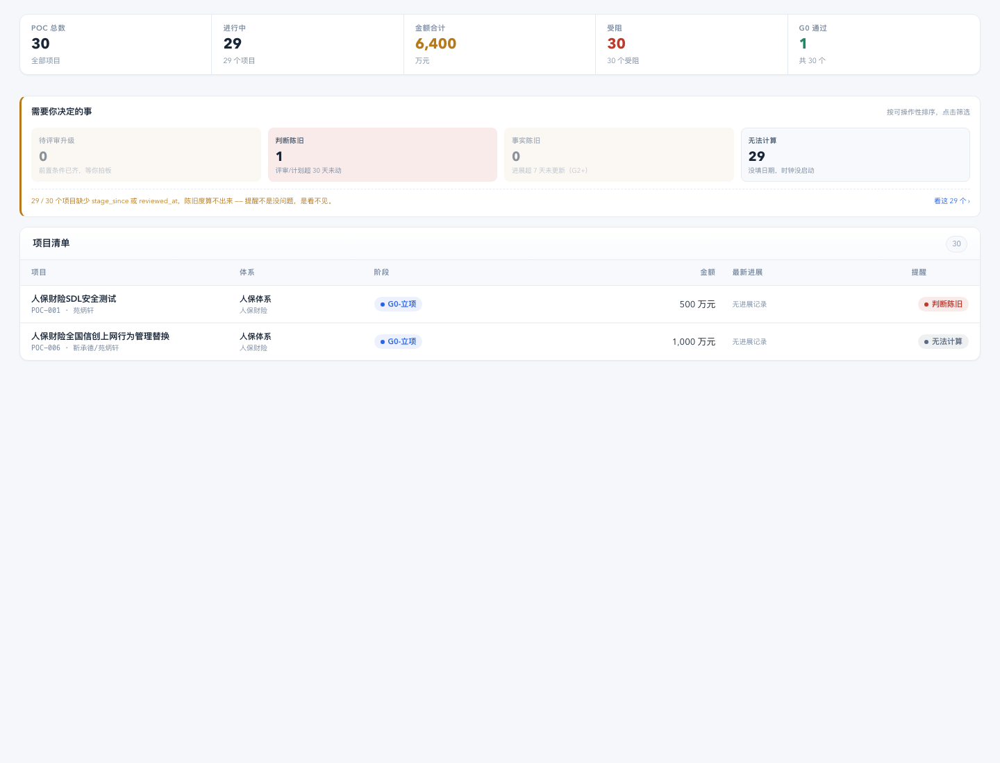
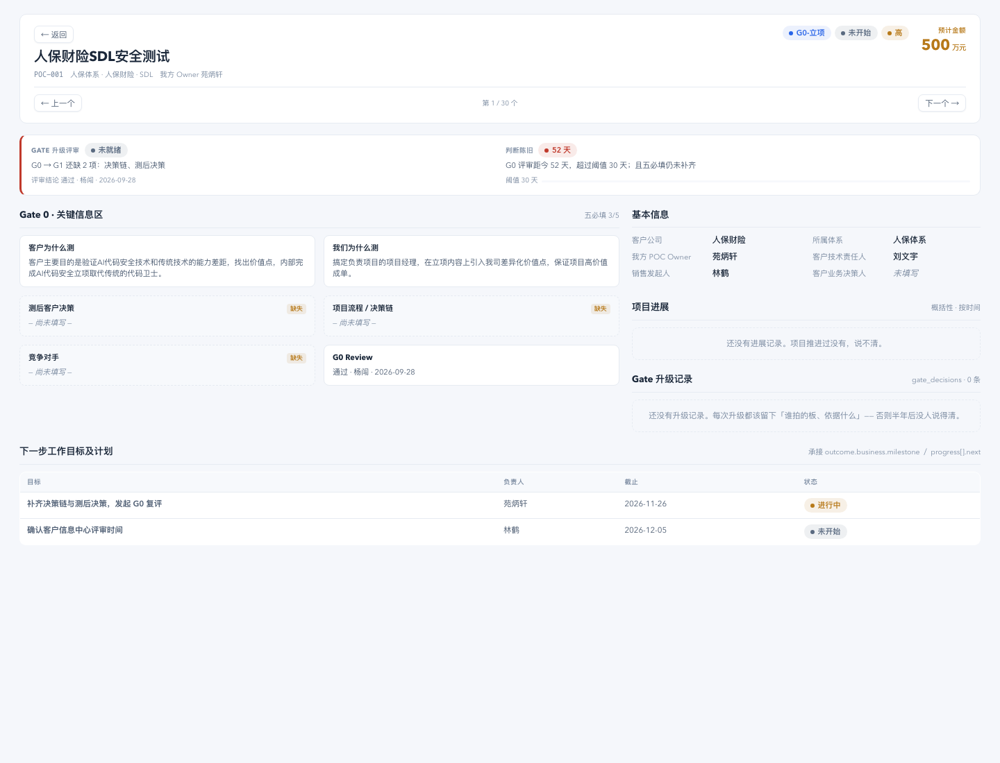

# 看板提醒：项目长期未更新 + Gate 升级评审

> 本文回答一个问题：**「这个项目该催了」和「这个 Gate 该评了」这两件事，在看板里怎么被看见、
> 怎么被点开、怎么被关掉。**
>
> 设计来源是会话「Superagent字段仓库优化与旧机部署」中定下的两层陈旧度模型
> （`config/health.yaml` 的 `facts` / `judgment`）与 `signals/` 的 `gate_upgrade` 块。
> 本文只负责**看板这一侧**：如何计算、放在哪里、四种状态各长什么样。

---

## 0. 先说结论：现在这两个提醒**一条都显示不出来**

设计已经存在于台账仓库，但插件侧只解析、不计算、不渲染。三个具体断点：

| 断点 | 证据 | 后果 |
|---|---|---|
| `config/health.yaml` 解析了但**从未使用** | `src/signals.ts` 的 `parseHealthConfig()` 把阈值解析进 `HealthThresholds`，但**全部 6 个阈值字段在 `src/` 和 `tests/` 内零引用**；唯一被读的 `health.source` 只用来填 `RulesProvenance.healthSource` 一个字符串 | 阈值读进来就扔了，陈旧度从来没被算过 |
| `signals/*.yaml` 解析了但**从未消费** | `store.ts:164` 调用 `parseSignals()`，结果只被用来取 `.warnings`；`ProjectSignal` / `gateUpgrade` / `health` 在 `signals.ts` 之外**零引用** | AI 写的升级建议进了内存，然后被丢掉 |
| `gate_decisions[]` 有类型但**从未读取** | `types.ts:147` 定义 `GateDecisionRecord`，`types.ts:293` 声明字段，`src/` 内**零引用** | 升级审计轨迹在 YAML 里，看板完全看不见 |

所以本文交付的不是"给已有功能加个角标"，而是**把三条已经设计好、但断在插件里的链路接通**。

同时必须承认一个数据现实（下面 §1 有完整统计）：**30 个项目中 29 个连时钟都没有**。
所以这个设计的核心不是"标红"，而是**区分"没问题"和"看不见"**——这是它能用的前提。

---

## 1. 为什么必须拆成两种陈旧度（用真实数据说话）

### 1.1 一个"7 天没更新"规则会怎样

会话二最初草稿写的是「周五检查、超 7 天提醒」。拿今天的真实台账算一遍：

```
30 个项目 → progress 记录 0 条 → 最后进展日期全部为 null
按"超 7 天未更新"判定 → 30 / 30 全部命中
```

**第一天就 30 个全红。** 一个对什么都报警的提醒不是提醒，是背景噪音，两周后所有人都会无视它。

### 1.2 两层时钟的实际覆盖率（今天实测）

| 时钟 | 字段 | 覆盖 | 含义 |
|---|---|---|---|
| 阶段时钟 | `stage_since` | **1 / 30** | 进当前阶段多久了 |
| 判断时钟（G0） | `gate0.review.reviewed_at` | **1 / 30** | G0 评审多久没重看 |
| 判断时钟（G1） | `plan.gate1.reviewed_at` | 0 / 30 | — |
| 判断时钟（G2） | `plan.gate2.checked_at` | 0 / 30 | — |
| 事实时钟 | `progress[].date` | **0 / 30** | 多久没新事实 |

唯一可测的是 POC-001：

```
stage_since    = 2026-09-28  → 距今 52 天  > stall_days 45  → 停滞
gate0.reviewed_at = 2026-09-28 → 距今 52 天  > g0_review_stale_days 30 → 判断陈旧
gate0.complete = false（还缺 decision_chain / post_poc_decision）
```

### 1.3 结论：提醒分四类，不是两类

| 类 | 判定 | 为什么单独一类 |
|---|---|---|
| **待评审升级** | 前置条件齐 + 未升 | 这是**唯一需要人拍板**的，应该置顶 |
| **判断陈旧** | 评审/计划日期超阈值 | "没人再看它了"，改一次日期就能消 |
| **事实陈旧** | 最新进展超阈值（仅 G2+） | "事情没动"，只能靠真做事消 |
| **无法计算** | 缺 `stage_since` / `reviewed_at` | **不是健康，是盲区**，必须显式计数 |

第四类是这份设计的关键。29 个项目没有日期，如果只统计前三类，看板会显示
"判断陈旧 1 个、其余正常"——这是**用沉默撒谎**。必须把"算不出来"当成一种状态显示出来。

---

## 2. Gate 升级评审：状态机

### 2.1 四级判定（纯函数，无时钟依赖，除最后一级）

```
读 record：
  gate0.complete          （派生，tools/derive.mjs 写）
  gate0.review.conclusion （人写）
  stage                   （人写）
  signals/<id>.yaml 的 gate_upgrade.eligible （agent 写）

not-ready    gate0.complete === false           → 还缺前置，列出 missing
ready        complete && conclusion === 通过    → 可以升，等人拍板
suggested    ready && signal.gate_upgrade.eligible → AI 也建议升
blocked      conclusion ∈ {未通过-退出, 未通过-降级} → 已否决，不再提示升级
```

`blocked` 这一级容易被漏掉。G0 结论有五个枚举值，其中两个是**否决**：

```
g0_conclusion: 通过 / 未通过-退出 / 未通过-降级 / 待评审
```

一个 G0 被否决的项目，如果只按 `complete` 判定，会显示"待评审升级"——
这是在**催人做一件已经被否决的事**。必须显式识别否决态。

### 2.2 各阶段的"升级就绪"看什么

不同 Gate 的升级依据在不同字段，不能统一用 `gate0.complete`：

| 当前 | 下一阶段 | 就绪依据 | 否决枚举 |
|---|---|---|---|
| G0 | G1-方案设计 | `gate0.complete && review.conclusion === 通过` | 未通过-退出 / 未通过-降级 |
| G1 | G2-方案验证 | `plan.gate1.conclusion === 通过` | 未通过 |
| G2 | G3-结果验证 | `plan.gate2.ready === Ready` | 未Ready |
| G3 | G4-结果转化 | 最新进展 `gate3_2 === 已确认` | 待确认 |
| G4 | closed | `outcome.achievement === 达成` | 未达成 |

注意 `G1 → G2` 的枚举里有一个特殊值 `补充后进入`——它**不是否决，也不是通过**，
是一个"带着条件往前走"的状态。它应该显示为 `ready` 但带一条说明，不能归到 `blocked`。

### 2.3 为什么要区分「AI 建议」和「人拍板」

`signals/gate_upgrade.eligible` 是 agent 的判断，`gate_decisions[]` 是人的决定。
两者必须**在视觉上分开**，否则半年后没人分得清"这级是系统自动升的，还是有人签字升的"。

这也是台账 `signals/README.md` 里那条硬规则的界面体现：

> 判断不落进 `projects/`。`gate_decisions[]` 记录的是"人采纳了哪次建议"，不是建议本身。

---

## 3. 三层呈现

### 3.1 第一层：组合视图的「需要你决定的事」带

位置：**KPI 条之下、项目清单之上**。理由：这是唯一"需要动作"的信息，
压在 30 行长表下面等于没有。



四个磁贴 + 一条脚注：

| 磁贴 | 数字 | 点击行为 |
|---|---|---|
| 待评审升级 | 0 | 筛选出这些项目 |
| 判断陈旧 | 1 | 筛选 |
| 事实陈旧 | 0 | 筛选 |
| **无法计算** | **29** | 筛选出"缺日期"的项目 |

脚注那句是刻意写的：

> 29 / 30 个项目缺少 stage_since 或 reviewed_at，陈旧度算不出来 ——
> 提醒不是没问题，是看不见。

**为什么用磁贴而不是列表**：列表要排序，而"待评审升级"和"事实陈旧"之间没有可比的优先级
（一个是 5 分钟能做完的决定，一个是 3 周的活）。磁贴把分类和计数说清楚，点进去再排序。

**为什么 0 也要显示**：只显示非零的磁贴，会让"0"和"这个检查不存在"长得一样。
四个磁贴永远都在，`data-zero="true"` 时降透明度，布局不跳动。

### 3.2 第二层：项目详情页的提醒条

位置：**横幅之下、两栏之上**，通栏。理由：它同时涉及左栏（Gate 0 前置）和右栏
（基本信息里的日期），放在任一栏里都会让读者以为它只跟那一栏有关。

四种状态（下面每张图都用插件真实 CSS 渲染）：

#### A. 判断陈旧（可计算、已超阈值）



```
左：GATE 升级评审   ●未就绪
    G0 → G1 还缺 2 项：决策链、测后决策
    评审结论 通过 · 杨闯 · 2026-09-28

右：判断陈旧       ●52 天
    G0 评审距今 52 天，超过阈值 30 天；且五必填仍未补齐
    阈值 30 天  [██████████]
```

左侧红色左边框（`data-tone="red"`）。

#### B. 无法计算（缺日期）


```
左：GATE 升级评审   ●未就绪
    G0 → G1 还缺 3 项：决策链、测后决策、客户技术责任人
    未填 G0 评审日期

右：陈旧度         ●无法计算
    没填 stage_since 与 reviewed_at，两个时钟都没启动
    补日期后才能算
```

左侧灰色左边框（`data-tone="slate"`）。**这一格不能空着**——空着就等于"健康"。

#### C. 待评审升级（前置齐、等拍板）


```
左：GATE 升级评审   ●待评审
    五必填已齐、G0 评审通过 —— 可以升 G1，等你拍板
    依据：gate0.complete · gate0.review.conclusion

右：AI 建议        ●建议升级
    客户已确认进入方案设计，预算在 Q1 立项窗口内
    signals/POC-001 · 2026-11-18
```

左侧琥珀色左边框（`data-tone="amber"`）。**这是唯一需要人做决定的态**，所以它有
第二条格子专门显示 AI 依据——把"为什么现在提这个"和"提了什么"分开。

#### D. 已否决（G0 未通过）

不占提醒条，但 Gate 0 网格的 `G0 Review` 卡片显示红色结论，
且提醒条整体降级为灰色一行：「G0 结论「未通过-退出」，不再提示升级」。

**为什么单独处理**：`blocked` 是"这个项目已经结束了"，继续催升级是错的。

### 3.3 第三层：Gate 升级审计轨迹

位置：**详情页右栏**，在「基本信息」之后、「项目进展」之前。


```
Gate 升级记录                    gate_decisions · 1 条
● G0-立项 → G1-方案设计   [采纳 AI 建议]        2026-11-22
  靳承德 拍板 · 依据 signals/POC-001
  五必填补齐，客户确认进入方案设计
```

空态：

> 还没有升级记录。每次升级都该留下「谁拍的板、依据什么」—— 否则半年后没人说得清。

**为什么放在右栏**：它是"这个项目的历史"，与左栏"这个项目的承诺"平行。
放在进展流旁边，读者能直接对照"升级那次对应哪条进展"。

**`basis` 徽章分两种颜色**：`human` 绿、`agent-suggested` 蓝。这是整个设计里
唯一用蓝色表示"机器意见"的地方——蓝色是品牌色，默认属于导航和选中，
这里破例是因为"AI 建议 / 人拍板"这个区分必须在视觉上一眼可见。

---

## 4. 数据契约（不需要改台账仓库）

**本文的设计不需要台账加任何字段。** 全部读现有字段：

| 用途 | 现有字段 | 状态 |
|---|---|---|
| 阶段时钟 | `stage_since` | ✅ v3.1 已有 |
| 判断时钟 | `gate0.review.reviewed_at` / `plan.gate1.reviewed_at` / `plan.gate2.checked_at` | ✅ 已有 |
| 事实时钟 | `progress[].date` | ✅ 已有 |
| 升级就绪 | `gate0.complete` / `review.conclusion` / `plan.gate1.conclusion` / `plan.gate2.ready` | ✅ 已有 |
| 升级审计 | `gate_decisions[]` | ✅ v3.1 新增，30 个文件已打骨架 |
| AI 建议 | `signals/<id>.yaml#gate_upgrade` | ✅ 契约已定 |
| 阈值 | `config/health.yaml` | ✅ 已落库 |

**唯一缺的是插件侧的三个函数**：算陈旧度、算升级态、渲染。全部在插件内完成。

### 4.1 一个必须澄清的边界：`facts_stale_days` 谁来算

`config/derive.yaml` 明确把陈旧度列为 **`computed_only`**：

```yaml
computed_only:
  - R12-stalled-days
  - health.facts_stale_days
  - health.judgment_stale_days

forbidden_in_stored:
  - timestamp
  - generated_at
  - updated_at
```

理由写得清楚：这些值依赖今天的日期，写进文件会让每次运行都产生 diff。

**所以插件必须自己算，不能读 agent 写的值。** 具体地：

- 插件**自己**从 `stage_since` / `reviewed_at` / `progress[].date` 算天数
- `signals/<id>.yaml#health.facts_stale_days` 是 agent 在**它运行那天**算的，
  到你看板打开时已经过期了 → **不采信**
- agent 的 `health.reasons` / `next_action` 采信（那是判断，不是时钟）

这条边界如果不写清楚，一定会有人去读 signal 里的 `facts_stale_days`，
然后看板上的天数永远停在巡检那天的数字。

---

## 5. 判定细节

### 5.1 陈旧度的三个阈值，按阶段分别生效

`config/health.yaml` 的 `by_stage` 规定了每个阶段该看哪个检查：

```
G0:     [change_stale_days, g0_review_stale_days]
G1:     [change_stale_days, plan_stale_days]
G2-G4:  [change_stale_days, progress_stale_days]
closed: [change_stale_days]
```

关键点：**`progress_stale_days`（7 天）只对 G2+ 生效**。
G0/G1 的项目本来就不该有周度进展——它还在立项和方案设计。
如果对 G0 也用 7 天规则，就是 §1.1 那个 30 个全红的错误。

### 5.2 阈值来源的降级

`health.yaml` 读不到时用内置 `FALLBACK_HEALTH`（`src/signals.ts` 已有），
但必须在界面上**标明是 fallback**——这跟 `rules.yaml` 的处理一致：

```
rules: { source: 'ledger' | 'fallback', healthSource: 'ledger' | 'fallback' }
```

`healthSource === 'fallback'` 时，提醒带上角标「阈值来自内置默认值」。
理由与规则文件相同：**在错误的阈值下报告"没有发现"，正是这套台账最想防的静默漂移。**

### 5.2.1 一个必须先解决的重复：`stall_days` 有两份

`stall_days: 45` 同时写在两个文件里：

```
config/rules.yaml:22    stall_days: 45      ← 插件实际读这个（R12 用）
config/health.yaml:13   stall_days: 45      ← 插件读了但从未使用
```

两者现在都是 45，所以看不出问题。但**一旦有人只改其中一个**：

- 改 `rules.yaml` → R12 用新值，提醒条用旧值，同一个项目两处结论不同
- 改 `health.yaml` → 改了等于没改，因为没人读它

这与台账自己那条「三份规则副本会漂移，一份不会」的原则直接冲突。
**实施 T1 之前必须先裁决**，两个选项：

| 选项 | 做法 | 代价 |
|---|---|---|
| **A（推荐）** | 删掉 `health.yaml` 的 `stall_days`，统一由 `rules.yaml` 提供 | 要改台账仓库一行 |
| B | 插件读 `health.yaml`，`rules.yaml` 那份标为 deprecated | 与 R12 的现有实现冲突 |

本文默认按 A 实施：提醒的"停滞"判定与 R12 共用 `rules.yaml#thresholds.stall_days`，
`health.yaml` 只负责它独有的四件事（`progress_stale_days` / `change_stale_days` /
`g0_review_stale_days` / `plan_stale_days`）。

### 5.3 三种"不提示"的情况

不是所有项目都该出现在提醒里：

| 情况 | 处理 |
|---|---|
| `status ∈ {暂停, 已关闭, 已取消}` | 不提示。已经停了，催它没意义 |
| `stage === closed` | 不提示 |
| G0 结论是 `未通过-退出` / `未通过-降级` | 不提示升级（见 §3.2 D） |

但要**计数**：组合视图脚注写明「N 个项目已暂停/关闭，未计入」。
否则"总共 30 个，提醒里只有 1 个"会让人以为漏了。

### 5.4 排序

组合视图磁贴点进去后的列表排序：

```
待评审升级 > 判断陈旧 > 事实陈旧 > 无法计算
同组内：金额降序（先看值钱的）
```

**"无法计算"排最后但不是隐藏**——它是待办（补日期），不是紧急。

---

## 6. 实施拆分

三件事，互相独立，可以分别发版。

### T1 · 计算层（Host）

新增 `src/reminders.ts`：

```ts
export interface ReminderState {
  pocId: string
  /** 四类之一；`unknown` 表示时钟缺失 */
  kind: 'gate-ready' | 'judgment-stale' | 'facts-stale' | 'unmeasurable'
  /** 已否决的项目不产生提醒，但保留状态供详情页显示 */
  blocked: boolean
  /** 时钟读数，`null` 表示该时钟不存在 */
  stageDays: number | null
  judgmentDays: number | null
  factsDays: number | null
  /** 已生效的阈值，供 UI 画进度条 */
  thresholdDays: number | null
  reasons: string[]
}

export function scanReminders(record: PocRecord, options: ReminderOptions): ReminderState[]
```

要点：
- 纯函数，`now` 由 `ScanOptions` 注入（与 `scanGaps` 一致，测试可钉住日期）
- 阈值从 `HealthThresholds` 传入，**不读 signal 里的天数**
- 一个项目**可以同时**产生"待评审升级"和"判断陈旧"两条吗？
  **不能**。待评审升级是"该动了"，判断陈旧是"没人看"——已经催你升级时再说"没人看"是重复。
  判定顺序：`gate-ready` 命中则不再出 `judgment-stale`

### T2 · 升级态（Host）

新增 `src/gate.ts`：

```ts
export interface GateUpgradeState {
  from: string
  to: string
  status: 'not-ready' | 'ready' | 'suggested' | 'blocked' | 'closed'
  missing: string[]
  /** 人写的事实依据 */
  basis: string[]
  /** agent 的建议，可能为 null */
  suggestion: { eligible: boolean; note: string; generatedAt: string } | null
  /** 是否已有人拍板升过（读 gate_decisions） */
  decided: GateDecisionRecord | null
}

export function gateUpgradeOf(record: PocRecord, signal: ProjectSignal | null): GateUpgradeState
```

要点：
- `blocked` 必须显式识别（§2.1）
- `补充后进入` 归 `ready` 而非 `blocked`（§2.2）
- `suggestion` 来自 `signals/`，`decided` 来自 `gate_decisions[]`，**两者不合并**

### T3 · 渲染层（Client）

| 位置 | 改动 | 文件 |
|---|---|---|
| 组合视图 | 新增 `.rm-band` 磁贴带 | `src/client/overview.tsx` |
| 详情页 | 新增 `.rm-strip` 提醒条 | `src/client/detail.tsx` |
| 详情页右栏 | 新增 Gate 升级记录 | `src/client/detail.tsx` |
| 项目表 | 新增「提醒」列 | `src/client/overview.tsx` |
| 样式 | `.rm-*` / `.gd-*` | `src/client/css/detail.ts` |
| 文案 | `rm*` / `gd*` 键（zh + en） | `src/client/text.ts` |

**关键约束：详情页的固定两栏不能动。** 提醒条是通栏的，插在两栏之上，
不改变左右栏的内容分配——这是 0.10.1 刚修好的问题（见 `docs/DETAIL.zh.md`）。

### 6.1 测试

| 层级 | 内容 |
|---|---|
| L2 单元 | `scanReminders` 四类判定 + `gateUpgradeOf` 五态，用固定 `now` |
| L2 单元 | 阈值缺失 → `unmeasurable`，**不是** `ok` |
| L2 单元 | `status=暂停` / `stage=closed` → 不产生提醒 |
| L3 夹具 | 扩 `FIX-G0`：加 `stage_since` 造一个"停滞"样本；加 `gate_decisions` 造一个"已升级"样本 |
| L5 界面 | 四种状态各渲染一次（就是本文四张图） |

---

## 7. 一个必须现在就承认的限制

**这个功能上线后，前 29 个项目会显示「无法计算」。**

这不是 bug，是数据的真实状态：`stage_since` 只有 1 个填了。要让提醒真正工作，
需要有人在台账里补日期——而补日期这件事本身，正是这套提醒要推动的第一个动作。

所以实施顺序上有个选择：

| 方案 | 效果 | 代价 |
|---|---|---|
| **A. 先做提醒**（本文） | 上线即显示 29 个"无法计算"，用可见的盲区逼人补日期 | 第一印象是"全是灰的" |
| **B. 先补日期** | 提醒上线即有意义 | 补 29 个日期是纯人工活，且没有界面提示该补 |

**建议 A**，但把脚注文案写死（§3.1 那句），让"29 个无法计算"读起来是
"提醒你在补日期"，而不是"这个功能坏了"。

补日期的入口已经有了：`poc-export` 表单导出 → 组员填 → `poc-submit` 提 PR。
不需要为这件事新做界面。

---

## 8. 待你拍板

1. **「无法计算」是磁贴还是脚注？** 我做成磁贴（第 4 格），因为它是一个
   需要动作的状态，不是说明文字。但如果你觉得它太抢眼，可以降成脚注。
2. **提醒条放在横幅下、两栏之上，还是塞进右栏？** 我选通栏，因为它同时涉及
   左栏（G0 前置）和右栏（日期）。塞进右栏会让人以为它只管基本信息。
3. **「已否决」要不要单独一态？** 我做了（§3.2 D），因为 `未通过-退出` 和
   `未通过-降级` 是两个真实枚举值，不处理就会催人做已否决的事。
4. **Gate 升级记录放右栏还是左栏？** 我选右栏（历史与事实在一起）。
   但如果你认为"升级轨迹"属于承诺而非历史，放左栏 Gate 0 下面也成立。

---

## 附：本文用到的真实数据

全部来自 `~/.dsh/cache/work-dashboard/repo`（`skillre/workbranch@a24b5aa`），
采样时间 2026-11-19：

```
项目数                 30
进度记录               0 条（30/30 为空）
stage_since 覆盖率      1/30
gate0.reviewed_at 覆盖  1/30
gate1.reviewed_at 覆盖  0/30
gate2.checked_at 覆盖   0/30
gate_decisions 条目     0 条（30 个文件均为 []）
signals/*.yaml          仅 README，无实际 signal
G0 评审通过             1 个（POC-001，2026-09-28）
阶段分布                30/30 全部 G0-立项

POC-001 实测：
  stage_since        2026-09-28 → 52 天 > 45 → 停滞
  reviewed_at        2026-09-28 → 52 天 > 30 → 判断陈旧
  gate0.complete     false（缺 decision_chain / post_poc_decision）
  gate0.conclusion   通过
  → 命中「判断陈旧」，未命中「待评审升级」
```

四张截图由 `/tmp/hc/build.mjs` 用 `src/client/styles.ts` 导出的真实
`CONSOLE_CSS` 渲染，非手绘——所以图上每个间距、字号、颜色都是插件实际会输出的值。
